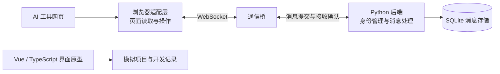
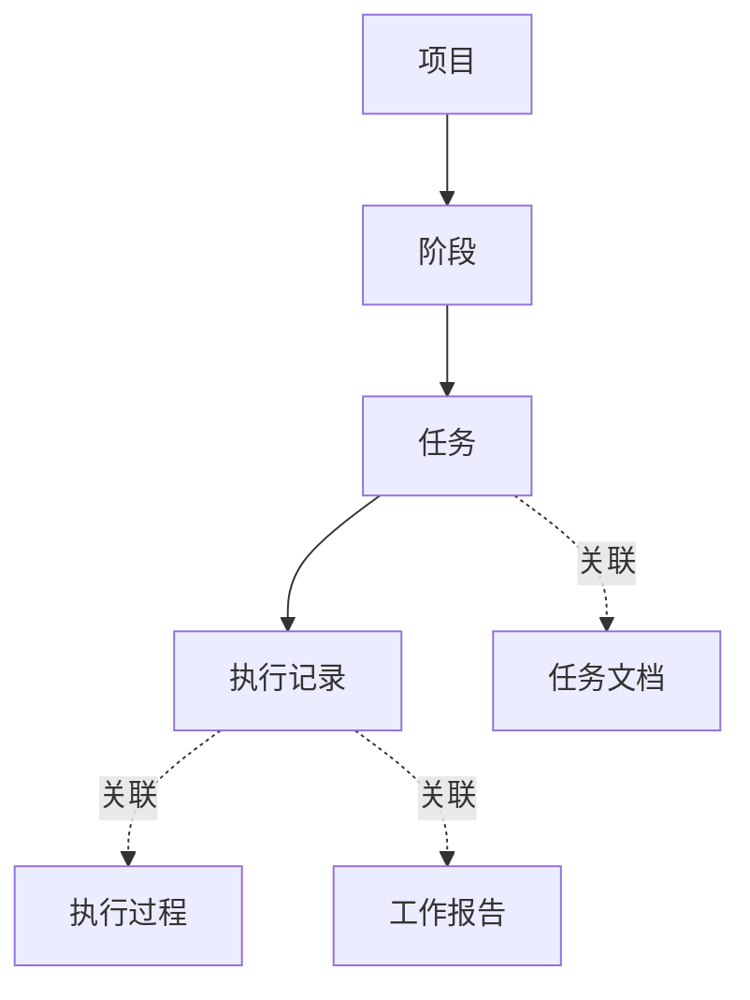

# CortexFlow

CortexFlow 是面向长期 AI 辅助开发的上下文管理系统。

长期项目中的对话、任务、执行过程和工作成果往往分散在不同 AI 工具与会话中。重新开始工作时，需要反复查找背景、确认任务状态，并拼接上次工作的结果。CortexFlow 希望将这些信息按项目与任务组织起来，让开发过程可以被追溯，工作上下文可以被理解和恢复。

## 设计思路

### 将工具接入与核心数据分开

网页结构和不同 AI 工具的交互方式会变化。浏览器适配层负责读取和操作页面，通信桥负责连接，后端负责身份、消息与数据。上层通过统一接口访问这些能力，避免把某个工具的 DOM 细节带入项目数据模型。

系统分别记录 Agent 身份、对话会话和实际页面位置。这样，同一个会话被重复打开、页面离线或访问位置变化时，可以明确定位问题，而不是只按当前标签页猜测消息来源。

### 用开发结构组织线性对话

对话按时间展开，软件开发却围绕任务推进。项目采用“项目—阶段—任务—执行记录”四级结构，把任务文档、执行过程与工作报告放回具体工作的位置，便于回顾一次任务为何开展、如何执行、留下了什么结果。

### 在接收时处理重复和冲突

浏览器与后端之间可能出现重发。消息保存时在 SQLite 事务中核对提交标识与内容指纹：同标识、同内容返回已有记录；同标识、不同内容返回冲突。该处理针对消息接收，不自动推导外部任务已经执行成功。

## 系统架构



通信与消息持久化已有实现。界面原型使用独立的模拟数据入口，图中没有将它画成已接通后端的数据链路。

## 开发信息的组织方式



这是项目与界面采用的组织模型。项目及任务层级的数据存储已有本地实现，支持父子层级校验、项目范围查询、原子写入、更新冲突检查和显式数据库迁移；与当前公开后端版本的同步仍在进行。

## 界面原型


截图来自实际运行的界面原型，页面标注的 Mock 表示业务内容是模拟数据，不能用来证明真实 Agent 任务已经执行。

## 运行方式

从仓库根目录启动界面原型：

```bash
cd cortexflow-ui-demo
npm ci
npm run dev
```

开发服务器使用 127.0.0.1，项目配置端口为 5176。

```bash
npm run build
npm test
```

后端使用 Python 3.10。依赖配置见 [后端说明](https://github.com/Nuwanda218/CortexFlow/blob/main/contextflow-research/README.md)。另开终端，从仓库根目录执行测试入口：

```bash
cd contextflow-research
python -B -m pytest tests -q -p no:cacheprovider
```

## 测试与验证

项目包含消息事务、重复提交、冲突、会话定位及界面交互等自动化检查。真实 Agent 测试通过显式选项启用，与本地模拟测试分开；自动化结果对应各自的代码版本和运行环境。

## 当前状态与限制

- 当前公开代码包含浏览器接入、消息处理等后端能力及独立界面原型；两者尚未完成真实数据集成。
- 项目工作区的数据存储正在本地演进，公开仓库与本地开发版本分开维护。
- 项目的目标包含开发上下文组织与恢复，真实工具、Agent 执行及完整使用链路仍需要分别验证。

## 开发与相关链接

我围绕需求、模块边界和开发信息组织推进设计，并使用 AI 辅助实现、集成与验证。方案设计、代码修改和验收分别记录，便于持续改进。

[源代码](https://github.com/Nuwanda218/CortexFlow) · [返回项目索引](README.md)

更新：2026-11-25
