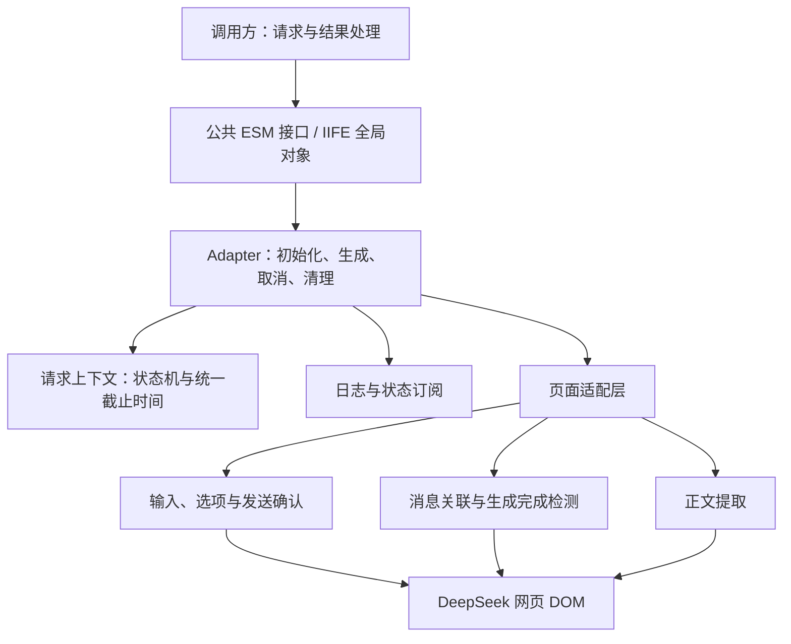
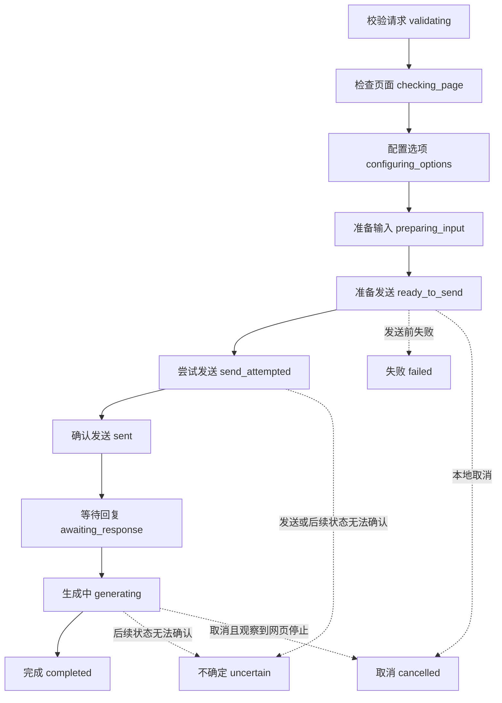

# DeepSeek Web Adapter

DeepSeek Web Adapter 将已有 DeepSeek 网页会话封装为 JavaScript 模块。调用方提交请求，模块负责填写输入、确认发送、等待生成、关联回复并提取完整结果，上层应用只需处理统一的结果与错误。

它不依赖 Tauri、Tampermonkey 或私有 DeepSeek API，可作为 ESM 模块调用，也可构建为单文件 IIFE 注入页面。[uXueScript 集成](uxuescript-contribution.md)是它的一个实际应用。

## 为什么独立封装网页操作

网页调用并不是“点击发送，然后读取最后一条消息”。输入控件可能异步更新，历史消息采用虚拟列表，发送后还会短暂出现空占位；看见内容变化，也不一定代表它属于当前请求或已经生成完成。

如果这些判断散落在题目处理、桌面窗口和业务代码中，页面结构变化就会牵动多个模块，也难以统一判断失败发生在哪一步。因此，Adapter 集中管理 DOM 操作、发送确认、生成状态检测和回复关联，将网站变化限制在页面适配层内。业务代码通过请求与结果接口调用，而不直接依赖网页选择器。

## 模块结构



`index.js` 只公开版本、实例创建和实例查询三个入口；`adapter.js` 编排一次请求，`request.js` 管理状态、时间与清理回调，`page/` 隔离选择器、输入控件和消息处理。页面内只允许一个存活实例，实例注册与释放由 `registry.js` 管理。

## 请求如何完成

请求从页面检查开始，依次配置开关、准备输入、尝试发送、确认用户消息、等待对应回复，最后提取正文。下面展示成功主链及主要结束分支；异常和取消可以发生在多个阶段。



**发送确认与回复关联。** 点击发送前记录消息快照；点击后，通过输入内容、消息签名及出现次序确认新用户消息，再寻找其对应的助手消息。这样不必假设虚拟列表始终保留完整历史，也不会把空占位当作正式回复。

**所有阶段共用一个截止时间。** 请求创建时确定绝对截止时间，页面等待、发送确认和生成观察均使用剩余时间，避免每进入一个阶段就重新获得完整超时额度。部分操作还可以设置更短的阶段上限。

**把发送状态与请求状态分开。** `not_sent` 表示尚未尝试发送，`unknown` 表示已尝试但无法可靠确认，`confirmed` 表示已从页面证据确认发送。确认发送以后仍可能发生生成失败或超时；不确定结果不会自动重发，以免造成重复消息。

**取消与清理有各自职责。** `cancel(requestId)` 中止本地等待，并在仍能确认页面与请求归属时尝试点击停止、观察网页变化。`dispose()` 会取消活动请求、等待其退出，再清除会话缓存、订阅和实例注册；它不是简单地删除全局变量。

## 接口与最小调用示例

ESM 包根导出 `VERSION`、`createDeepSeekAdapter(options?)` 和 `getDeepSeekAdapterInstance()`。模块导入不会访问 DOM、联网或创建实例；调用方先显式创建实例，再调用 `initialize()`。IIFE 加载后暴露同名 API 对象 `globalThis.DeepSeekWebAdapter`，同样不会自动初始化或发送消息。

以下示例在**已经加载独立 IIFE 的 DeepSeek 页面控制台**执行。它会实际发送一条文本请求；执行前需由操作者确认已登录、已打开受支持会话，且输入框为空、无附件、没有其他生成任务。

```javascript
const api = globalThis.DeepSeekWebAdapter;
if (!api) throw new Error('请先加载 deepseek-web-adapter.iife.js');

// 一个页面只允许一个存活实例；已有实例应由其创建方管理。
const adapter = api.createDeepSeekAdapter();

try {
  await adapter.initialize();
  const session = adapter.getSession();
  if (!session) throw new Error('会话未初始化');

  const result = await adapter.generate({
    requestId: crypto.randomUUID(),
    sessionId: session.id,
    parts: [{ type: 'text', text: '请只回复：连接成功。' }],
    options: {
      thinking: false,
      webSearch: false,
      timeoutMs: 120000,
    },
  });

  if (result.status === 'completed') {
    console.log(result.content);
  } else {
    // failed 或 uncertain；保留状态供调用方处理，不自动重发。
    console.error(result.status, result.error);
  }
} catch (error) {
  // 初始化失败或请求参数不合法等错误。
  console.error(error);
} finally {
  await adapter.dispose();
}
```

ESM 应用使用同一套实例方法。在已具备本地模块的环境中，可用下面的导入替换示例中的全局 API 获取方式：

```javascript
import * as api from 'deepseek-web-adapter';
```

`generate()` 接收 `requestId`、从 `getSession()` 取得的 `sessionId`、输入 `parts` 和可选 `options`。成功返回 `completed` 与完整 `content`；运行失败返回 `failed` 或 `uncertain` 及结构化 `error`。`timeoutMs` 位于 `options` 内；省略 `thinking`、`webSearch` 时保留网页当前设置。

状态图中的 `cancelled` 是内部请求状态；取消后的 `generate()` 结果仍使用 `failed` 或 `uncertain`，具体原因由结构化错误说明。

## 源码与本地构建

当前公开代码位于 uXueScript 开发分支中的 [Adapter 源码目录](https://github.com/Nuwanda218/uxuescript/tree/feat/nuwanda-web-solver/injected/deepseek-web/adapter-core)，其 [来源说明](https://github.com/Nuwanda218/uxuescript/blob/feat/nuwanda-web-solver/injected/deepseek-web/adapter-core/UPSTREAM.md)记录固定来源版本及必要的工具注解。

独立模块提供如下开发命令；需先取得其包含 `package.json`、锁文件和构建配置的完整源码目录，准备 Node.js 与 pnpm：

```sh
pnpm install --frozen-lockfile
pnpm test
pnpm typecheck
pnpm lint
pnpm format:check
pnpm build
```

`pnpm build` 生成 `dist/deepseek-web-adapter.iife.js`。公开的 uXueScript 源码副本则通过该应用原有的 `pnpm build:scripts` 构建，两者的项目根目录和命令不能混用。

## 测试与验证

本地测试覆盖请求状态、统一超时、错误处理、Mock DOM、ESM 导入及独立 IIFE 构建。包接口测试还在独立消费者环境中按真实包名导入，检查模块加载与构建结果。

已有真实网页记录验证了同一实例连续两轮文本生成、回复提取，以及 `dispose()` 后重新创建和初始化。过程中针对 React 开关异步更新、虚拟列表切换和空消息占位修正了页面判断。真实页面记录与受控测试分别验证网站行为和可重复构造的异常情形。

文中的最小示例已使用实际公开 API 与受控页面对象检查初始化、请求参数、成功结果和最终清理。真实网页结论对应已有验证版本，页面改版后需要重新验收。

## 当前状态与限制

- 独立包版本为 `0.1.0`、`private: true`，没有 npm 发布或独立公开仓库。公开入口是上述 uXueScript 源码目录；ESM 包名示例要求调用方已经具备本地安装或链接条件。
- 仅初始化已有 `/a/chat/s/<UUID>` 会话；登录、创建和切换会话由操作者完成。
- 单张 PNG 的输入与页面挂载已实现，真实页面只验证过挂载，尚未验收真实图片发送和模型理解；实际 uXueScript 集成只使用纯文本。
- 真实取消、超时与会话切换尚未全面验收。本地等待结束或网页出现停止状态，都不能保证远端计算已经终止。
- 返回完整文本，不提供 token 流接口。页面改版可能要求更新选择器与状态判断。

## 个人贡献与来源

本人负责方案设计、AI 辅助开发、集成与验证，工作包括模块接口、请求状态设计、页面适配问题定位，以及与 uXueScript 的集成。

独立模块来源提交为 `f4fdafe`。其 `package.json` 尚无 `license` 字段，根目录也没有 LICENSE/COPYING 文件，独立模块许可证仍待明确；uXueScript 的许可与上游归属见[集成说明](uxuescript-contribution.md)。

更新于 2026-11-25。
